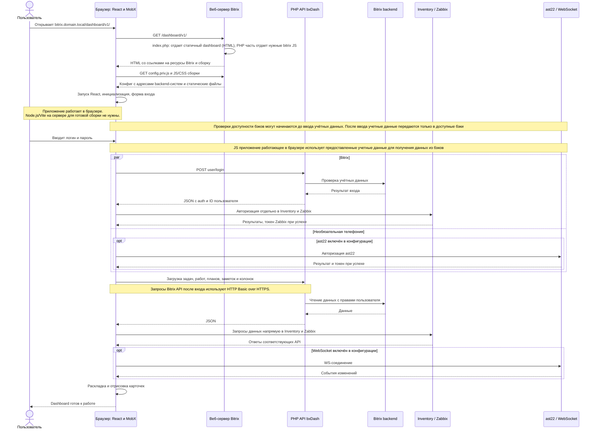

# Размещение bxDash в Bitrix и запуск приложения

Пример адреса приложения: `https://bitrix.domain.local/dashboard/v1/`.
Здесь `/dashboard/v1/` — каталог собранного frontend, а
`/dashboard/back/api/` — отдельный адрес PHP API bxDash внутри Bitrix.
Имена каталогов можно выбрать другие, согласовав пути сборки, конфиг и маршрутизацию.

## 1. Размещение файлов и конфигурация Apache/nginx

```text
DOCUMENT_ROOT/                           # Корень уже установленного сайта Bitrix
├── bitrix/                              # Существующее ядро; сюда bxDash не копируем
└── dashboard/
    ├── v1/                              # Содержимое build/ после npm run build
    │   ├── index.html                   # HTML собранного frontend
    │   ├── index.php                    # Обёртка: пролог и библиотеки Bitrix + HTML сборки
    │   ├── assets/                      # Собранные JS/CSS: приложение работает в браузере
    │   ├── config.priv.js               # Браузерный конфиг: URL backend-систем и настройки UI
    │   ├── portal.config.example.php    # Образец серверного профиля библиотек
    │   ├── portal.config.php            # Необязательный серверный профиль библиотек
    │   └── ...                          # Иконки, шрифты и остальные файлы build/
    └── back/                            # Содержимое back/; публикуется отдельно от build/
        ├── .htaccess                    # Apache: api/* → api.php
        ├── api.php                      # Точка входа PHP API bxDash
        ├── conf.example.php             # Образец серверного конфига
        ├── conf.php                     # ID инфоблоков, провайдер колонок и настройки API
        └── app/
            ├── router.php               # Разбор маршрута и вызов контроллера
            ├── ctl/                     # Контроллеры запросов
            └── models/                  # Провайдеры и серверная логика
```

Настройки веб-сервера находятся отдельно от дерева приложения. Ниже показаны
две альтернативы; конкретное имя файла виртуального хоста зависит от установки.

```text
Конфигурация веб-сервера сайта bitrix.domain.local
├── Apache — виртуальный хост сайта
│   ├── Каталог DOCUMENT_ROOT/dashboard/v1/
│   │   └── DirectoryIndex index.php index.html
│   ├── Каталог DOCUMENT_ROOT/dashboard/back/
│   │   └── Разрешены mod_rewrite и обработка опубликованного .htaccess
│   └── Существующий обработчик PHP Bitrix обслуживает index.php и api.php
└── nginx — блок server сайта
    ├── Каталог /dashboard/v1/
    │   └── index index.php index.html
    ├── Маршрут /dashboard/back/api/*
    │   └── Передача в /dashboard/back/api.php с сохранением исходного URI
    ├── Существующий обработчик PHP/FastCGI Bitrix обслуживает PHP-точки входа
    └── .htaccess не используется; правило API задаётся в конфигурации nginx
```

`npm run build` создаёт статическую сборку. Каталог `back/` в неё не входит:
его публикуют отдельно. Файлы `public/index.php` и `public/portal.config.example.php`
попадают в сборку вместе с остальным `public/`.

| Настройка | Где находится после публикации | Кто читает |
| --- | --- | --- |
| `base` Vite | При сборке задаётся в `vite.config.js` | Vite формирует URL ресурсов |
| `config.priv.js` | `/dashboard/v1/config.priv.js` | Браузер; файл доступен посетителю |
| `portal.config.php` | Рядом с `/dashboard/v1/index.php` | PHP-обёртка frontend |
| `conf.php` | Рядом с `/dashboard/back/api.php` | PHP backend bxDash |
| Индекс каталога и rewrite | Конфигурация виртуального хоста или разрешённый `.htaccess` | Apache/nginx |

В `config.priv.js` для этого примера:

```js
window.__CONFIG__ = {
	apiUrl: 'https://bitrix.domain.local/dashboard/back/api/',
	inventoryUrl: 'https://inventory.domain.local/',
	zabbixUrl: 'https://zabbix.domain.local/',
	wsUrl: false,
	asteriskUrl: false,
	userList: [], // Заполнить сотрудниками своего развёртывания.
};
```

Это фрагмент для объяснения адресов. Полный образец настроек —
[`public/config.priv.example.js`](../public/config.priv.example.js).
Это базовые адреса: helper Inventory добавляет `api/users/search`, helper
Zabbix — `api_jsonrpc.php`. Если сервис опубликован в подкаталоге, включите
его в базовый адрес. Указывайте завершающий `/`, поскольку пути запросов
добавляются к этим строкам и к `apiUrl`.
Пользовательские учётные данные вводятся в интерфейсе. `config.priv.js`
загружается в браузер, поэтому серверные секреты в нём не хранят.

Для открытия именно `/dashboard/v1/` веб-сервер должен выбирать `index.php`
раньше `index.html`. Например, у Apache для этого каталога —
`DirectoryIndex index.php index.html`; у nginx — соответствующая директива
`index index.php index.html` и уже настроенный обработчик PHP.
Без такого выбора откройте `/dashboard/v1/index.php` явно. В режиме
`index.html` запускается тот же React frontend, но без серверной обёртки ресурсов Bitrix.

Apache использует опубликованный `back/.htaccess`, если разрешены rewrite и
чтение `.htaccess`. Nginx `.htaccess` не читает: правило передачи
`/dashboard/back/api/*` в `/dashboard/back/api.php` нужно задать в виртуальном
хосте, сохранив исходный URI запроса. У текущего роутера фиксированное
смещение пути `router::$num_shift = 3`: пример `/dashboard/back/api/task/load/...`
ему соответствует. При другой глубине URL нужно согласовать смещение
в `back/app/router.php` или способ передачи параметров маршрута.

Обёртка и API используют существующий пролог установленного Bitrix. Приложение
подключает его из своих точек входа; код bxDash не требуется вставлять в ядро
Bitrix или `init.php`. Настройки приложения хранятся в его собственных файлах,
а подключение к БД выполняется средствами портала.

## 2. Последовательность обращений при инициализации



Frontend сам обращается к каждому backend по адресу из конфигурации.
PHP API bxDash обслуживает операции Bitrix; он не является общим прокси
авторизации Inventory, Zabbix или ast22. При разных origin серверы сервисов
должны разрешать необходимые браузерные запросы через CORS, включая заголовок
`Authorization`, где он используется.

Начало загрузки данных привязано к готовности соответствующей системы:
например, справочник категорий заявок загружается после авторизации Bitrix.
Схема показывает успешный запуск; при ошибках входа интерфейс получает
статус ошибки соответствующего backend. Телефония и WebSocket отключаются
значением `false`; обязательными системами остаются Bitrix, Inventory и Zabbix.

PHP на сервере выполняется при открытии обёртки и при запросах API. React,
MobX, раскладка карточек и обработка пользовательских действий выполняются
в браузере. Страницы задач/заявок, открываемые в iframe, отдельно обслуживает
Bitrix: для них важны сессия портала, его ресурсы и одинаковый origin при
обращении к `parent.BX`.

Связанные инструкции: [ресурсы и профили Bitrix](bitrix-resources.md),
[инфоблоки](bitrix-iblocks.md), [режимы канбан-колонок](bitrix-kanban.md).
