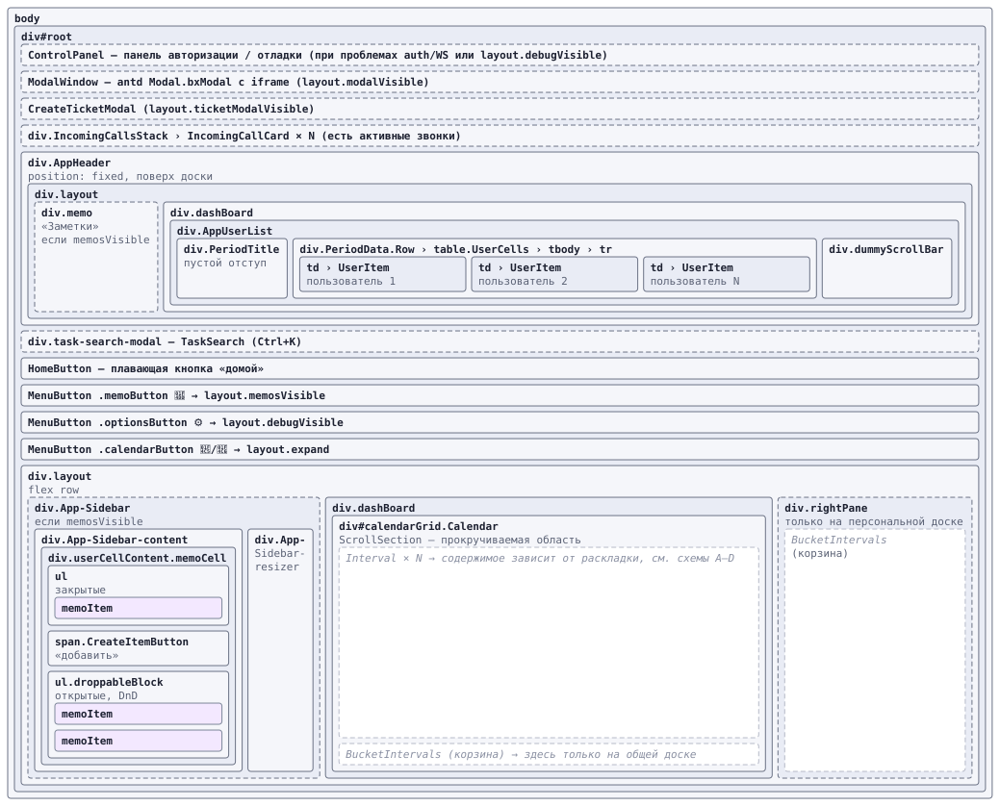
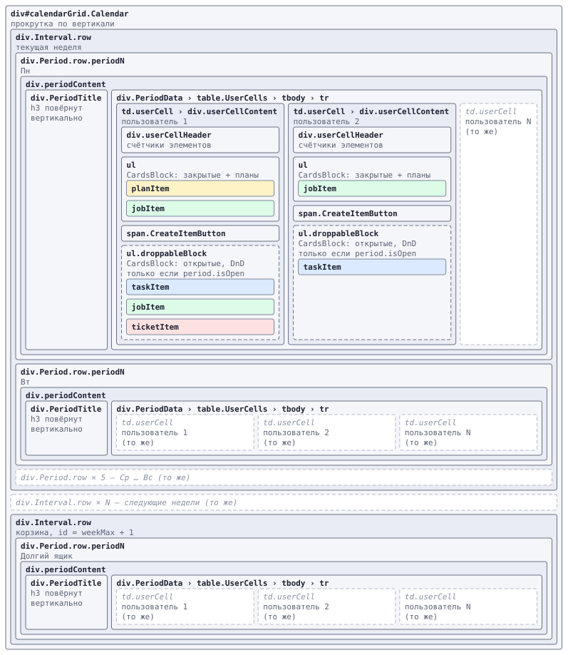
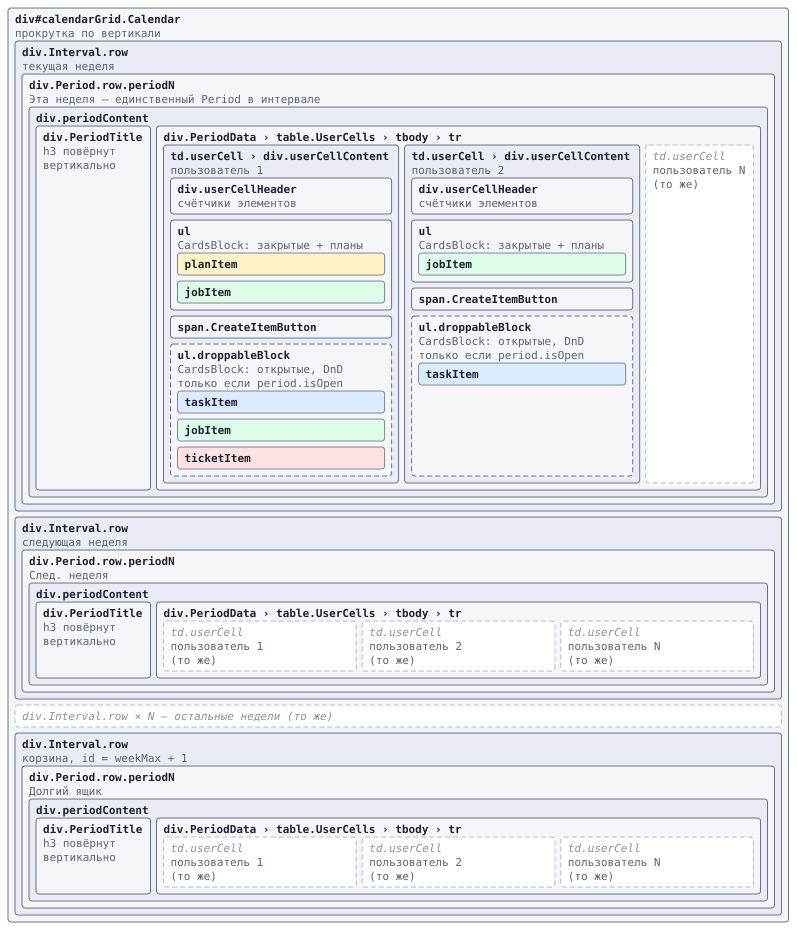
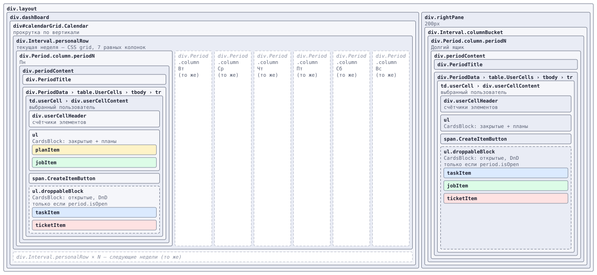
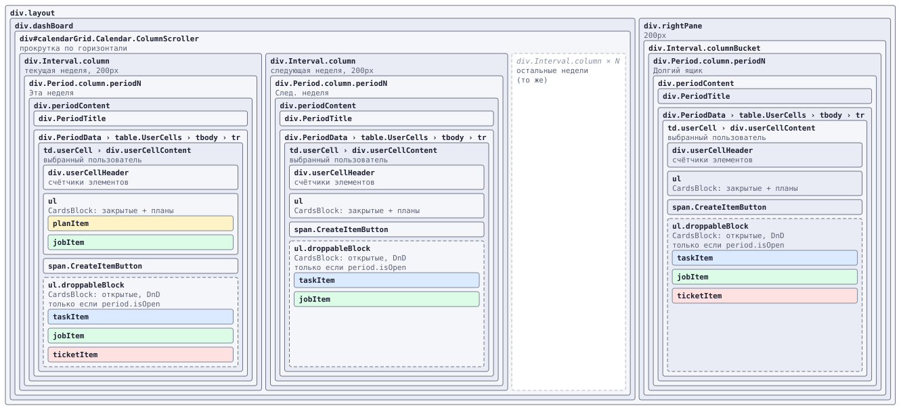
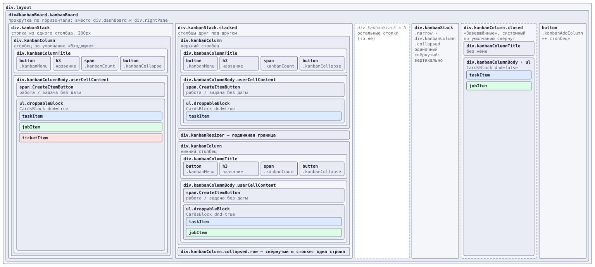
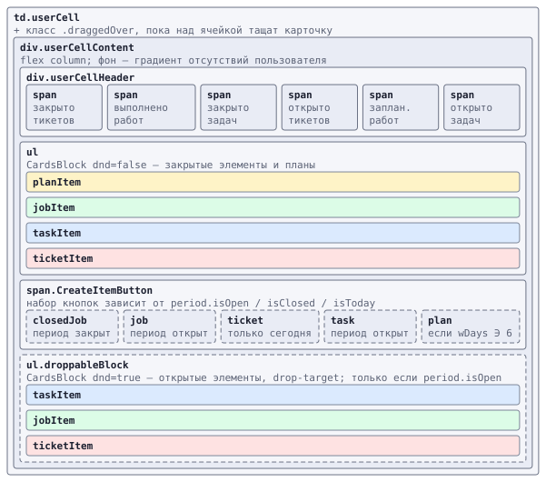
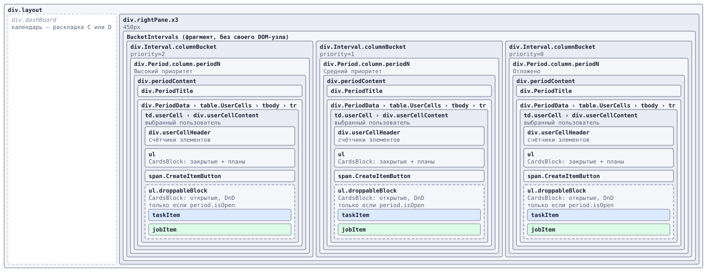
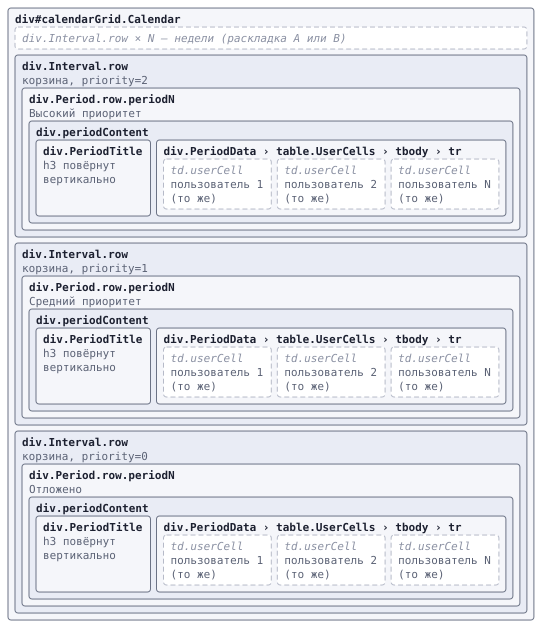

# Раскладки интерфейса

Документ описывает **вложенность HTML/UI-блоков** приложения bxDash — от `body` до карточки
элемента — во всех реализованных раскладках. Раскладка самой карточки здесь не рисуется:
карточки обозначены как `taskItem` / `jobItem` / `ticketItem` / `planItem` / `memoItem`.

Смежные документы: [architecture.md](architecture.md) (как элементы попадают в ячейки),
[uistyle.md](uistyle.md) (токены и стили).

---

## Параметры, определяющие раскладку

| Параметр | Где живёт | Значения | Что меняет |
|---|---|---|---|
| **personal** | `users.selected !== null` | общая доска / персональная доска | Ориентацию сетки: пользователи по горизонтали ↔ дни по горизонтали |
| **expand** | `layout.expand` | `true` — разбито по дням / `false` — свёрнуто в недели | Длину периода (`TimeHelper.dayLen` ↔ `weekLen`), т.е. сколько `Period` внутри `Interval` |
| **useSplitBucket** | `layout.useSplitBucket` | `false` / `true` | Корзина одной колонкой ↔ тремя колонками по приоритетам |
| **memosVisible** | `layout.memosVisible` | `false` / `true` | Левый sidebar с заметками |
| **kanban** | `layout.kanban` (действует только при `personal`, см. `layout.kanbanActive`) | `false` / `true` | Персональная доска: календарь ↔ канбан со столбцами |

`personal` и `expand` — две независимые оси, дающие **4 базовые раскладки**.
Пятая раскладка — **E, канбан**: при `personal && kanban` календарь и правая панель заменяются доской
со столбцами, `expand` на неё не влияет.
`useSplitBucket` и `memosVisible` — модификаторы, накладывающиеся на любую из них.

### Матрица базовых раскладок

| # | personal | expand | Класс `Interval` | Класс `Period` | Прокрутка календаря | Где корзина |
|---|---|---|---|---|---|---|
| **A** | нет (все) | да (дни) | `.Interval.row` | `.Period.row` | вертикальная | в конце `#calendarGrid` |
| **B** | нет (все) | нет (недели) | `.Interval.row` | `.Period.row` | вертикальная | в конце `#calendarGrid` |
| **C** | да | да (дни) | `.Interval.personalRow` (CSS-grid, 7 колонок) | `.Period.column` | вертикальная | в `.rightPane` |
| **D** | да | нет (недели) | `.Interval.column` (200px, inline-flex) | `.Period.column` | **горизонтальная** (`.Calendar.ColumnScroller`) | в `.rightPane` |
| **E** | да, `kanban` | не важно | — (`.kanbanColumn`, 200px) | — | **горизонтальная** (`.kanbanBoard`), столбцы — вертикально | нет: без даты лежит всё в столбцах |

Корзина («долгий ящик») — это псевдо-интервал с `id = time.weekMax + 1`; его `Interval`
всегда получает класс `.columnBucket` в персональном режиме и `.row` в общем.

Ключевые файлы: [`Layout.jsx`](../src/Components/Layout/Layout.jsx),
[`CalendarGrid.jsx`](../src/Components/Layout/CalendarGrid.jsx),
[`BucketIntervals.jsx`](../src/Components/Layout/BucketIntervals.jsx),
[`RightPaneBucket.jsx`](../src/Components/Layout/RightPaneBucket.jsx),
[`Interval.jsx`](../src/Components/Layout/Interval/Interval.jsx),
[`Period.jsx`](../src/Components/Layout/Interval/Period/Period.jsx).

---

## Как читать схемы

- Прямоугольник внутри прямоугольника = DOM-узел внутри DOM-узла.
- Порядок соседей = порядок в DOM и на экране: что раньше — выше или левее.
- `A › B` в заголовке — цепочка из единственных потомков, свёрнутая в одну рамку.
- **Пунктирная рамка** — блок рендерится по условию (оно подписано).
- *Серый курсив на белом* — свёрнутый повтор («ещё 6 таких же») или ссылка на другую схему.
- Цветные плашки — карточки: `taskItem` синяя, `jobItem` зелёная, `ticketItem` красная,
  `planItem` жёлтая, `memoItem` сиреневая.

Схемы — SVG из [`docs/layouts/`](layouts/), генерируются скриптом
[`tools/layouts-svg.cjs`](../tools/layouts-svg.cjs): правим описание в скрипте и запускаем
`node tools/layouts-svg.cjs`. (Mermaid для этого не подошёл: ни один его тип диаграмм
не умеет вложенные рамки с управляемым порядком соседей.)

---

## 1. Общий каркас (одинаков для всех раскладок)

`div.AppHeader` стоит в DOM выше `div.layout`, но позиционирован `fixed` и повторяет
структуру строки доски (`PeriodTitle` + `PeriodData` + `table.UserCells`), чтобы колонки
пользователей совпадали по ширине с ячейками. Кнопки `HomeButton` / `MenuButton` —
плавающие, в потоке места не занимают.

---

## 2. Раскладка A — общая доска, разбито по дням

`personal = false`, `expand = true`. Недели сверху вниз, в неделе 7 строк-дней,
в дне — колонки пользователей (ширина `100 / users.order.length %`).

---

## 3. Раскладка B — общая доска, свёрнуто в недели

`personal = false`, `expand = false`. Отличие от A одно: в интервале **один** `Period`
длиной в неделю.

---

## 4. Раскладка C — персональная доска, разбито по дням

`personal = true`, `expand = true`. Неделя — CSS-grid из 7 колонок-дней, недели сверху вниз.
Корзина переезжает в `div.rightPane`.

В `tr` по-прежнему лежат `td.userCell` всех пользователей, но невыбранные скрыты
`display: none` — на схеме показан только видимый.

---

## 5. Раскладка D — персональная доска, свёрнуто в недели

`personal = true`, `expand = false`. Недели — колонки по 200px слева направо, календарь
прокручивается **по горизонтали**. Ширина `#calendarGrid` считается вручную в
`CalendarGrid.jsx` (минус правая панель и sidebar).

---

## 5а. Раскладка E — персональная доска, канбан

`personal = true`, `layout.kanban = true` (`layout.kanbanActive`). Оси времени нет: все открытые
задачи, работы и заявки выбранного пользователя разложены по его столбцам независимо от даты.
`div.kanbanBoard` занимает место и `div.dashBoard`, и `div.rightPane`.

- Столбцы — стадии владельца доски (`stages.stagesOf(owner)`), у каждого пользователя свои.
  Ровно один столбец — «по умолчанию»: в нём всё, что явно никуда не привязано.
- Раскладку элементов по столбцам одним проходом считает `StagesStore.board`; столбцы только
  читают свою долю (как `PeriodItem.itemsByUser` в календаре).
- Внутри столбца — тот же `div.userCellContent` и тот же `CardsBlock`, что в ячейке календаря,
  поэтому стили карточек, привязанные к `div.userCellContent`, работают в обеих раскладках.
  **Не привязывать стили карточек к `td.userCell`** — в канбане его нет.
- Доска — ряд **стопок** (`div.kanbanStack`): в стопке один столбец на всю высоту или несколько
  друг под другом. Между развёрнутыми столбцами стопки — `div.kanbanResizer`, им меняют высоты
  (веса в `layout.kanbanHeights`, хранятся локально). Столбцы переставляют перетаскиванием за название.
- «Завершённые» — системный столбец (не стадия): закрытые элементы в пределах загруженной
  истории, без создания и перетаскивания.
- Свёрнутые столбцы хранятся в `layout.kanbanCollapsed` (id стадий и `'closed'`).
- Цвет стадии задаётся столбцу CSS-переменными `--kanban-color` / `--kanban-color-text`.
- Кнопки `HomeButton` и переключатель `expand` в этой раскладке скрыты.

Ключевые файлы: [`KanbanBoard.jsx`](../src/Components/Layout/Kanban/KanbanBoard.jsx),
[`KanbanColumn.jsx`](../src/Components/Layout/Kanban/KanbanColumn.jsx),
[`KanbanColumnTitle.jsx`](../src/Components/Layout/Kanban/KanbanColumnTitle.jsx),
[`StagesStore.jsx`](../src/Data/Stores/StagesStore.jsx). Замысел и история решений —
[`plans/bucket_columns.md`](../plans/bucket_columns.md).

---

## 6. Содержимое ячейки пользователя (общее для всех раскладок)

Ниже `td.userCell` структура от раскладки не зависит — её собирает
[`UserCellContainer.jsx`](../src/Components/Layout/Interval/Period/Data/UserCell/UserCellContainer.jsx).

Порядок карточек внутри `ul` задают `dashItemsSort` / `dashClosedItemsSort`, а не порядок
типов на схеме. Sidebar-заметки (`MemoCell`, см. схему каркаса) — та же конструкция без
`userCellHeader` и с карточками `memoItem`.

Фильтры видимости карточек (`ControlPanel`, читаются в `CardsBlock` / `TaskCard`):

| Флаг | Что скрывает |
|---|---|
| `tasksVisible` / `jobsVisible` / `ticketsVisible` / `plansVisible` | карточки соответствующего типа |
| `keepPlanning` | исключение: элементы, относящиеся к планам, остаются видимыми при выключенном типе |
| `accomplicesVisible` | задачи, где пользователь ячейки — соисполнитель, а не исполнитель |

---

## 7. Корзина («долгий ящик») и её split-режим

`BucketIntervals` — фрагмент без собственного DOM-узла. При `useSplitBucket = false` он
отдаёт один `Interval` (показан в схемах A–D), при `true` — три `Interval` с тем же `id`
и `priority = 2 / 1 / 0`. Фильтр по `priority` применяется только к открытым элементам.

Персональная доска — три колонки в `div.rightPane.x3`:

Общая доска — три строки в конце календаря:

---

## 8. Шпаргалка по CSS-классам раскладки

| Класс | Ставится когда | Смысл |
|---|---|---|
| `.Calendar` | всегда | контейнер прокрутки календаря (`#calendarGrid`) |
| `.Calendar.ColumnScroller` | `personal && !expand` | горизонтальная прокрутка недель-колонок |
| `.Interval.row` | `!personal` | неделя-строка (в т.ч. корзина) |
| `.Interval.personalRow` | `personal && expand`, не корзина | grid из 7 колонок-дней |
| `.Interval.column` | `personal && !expand`, не корзина | неделя-колонка 200px |
| `.Interval.columnBucket` | `personal`, корзина | корзина во всю высоту правой панели |
| `.Period.row` | `!personal` | период как `display: table` — заголовок слева, данные справа |
| `.Period.column` | `personal` | период как flex-колонка — заголовок сверху |
| `.Period.periodN`, `N = 0…7` | всегда | цветовая шкала удалённости периода от текущего |
| `.rightPane` / `.rightPane.x3` | `personal && !kanban` / + `useSplitBucket` | правая панель 200px / 450px |
| `.kanbanBoard` | `personal && kanban` | доска канбана вместо календаря и правой панели, прокрутка по горизонтали |
| `.kanbanStack` | раскладка E | стопка столбцов 200px; `.narrow` — одиночный свёрнутый столбец, `.stacked` — в стопке несколько столбцов |
| `.kanbanColumn` | раскладка E | столбец 200px; `.collapsed` — узкая полоска, `.closed` — системный «Завершённые», `.draggedOver` — над столбцом тащат карточку |
| `div.userCellContent` | всегда | контейнер списков карточек: в ячейке календаря, в столбце канбана и в заметках |
| `.App-Sidebar` | `memosVisible` | левая панель заметок, ширина ресайзится мышью |
| `td.userCell` | всегда | ячейка «период × пользователь»; в personal-режиме лишние скрыты `display: none` |
